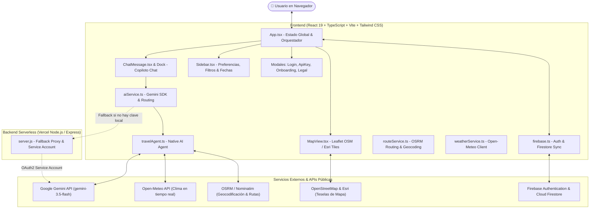
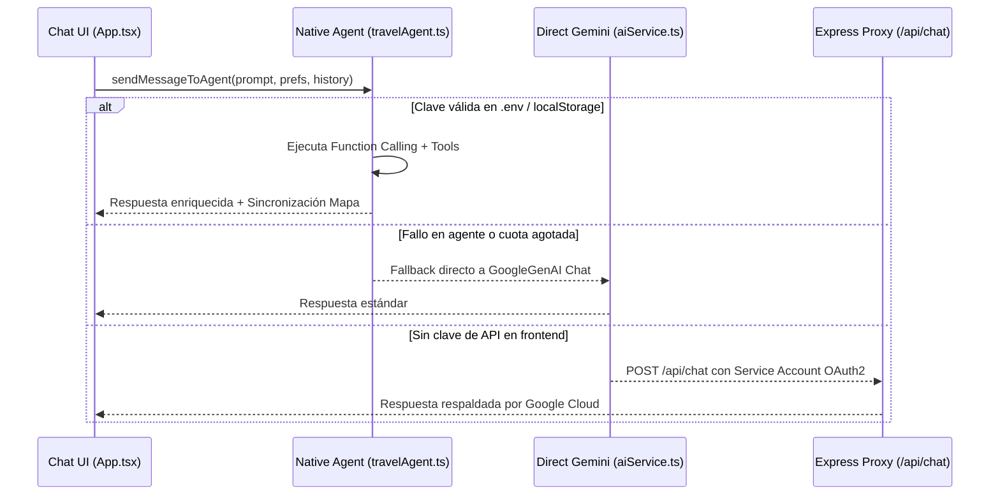

# 🧭 iTRAVEL_MAP — Dossier Técnico de Arquitectura para IA (AI Architecture Blueprint)

> **Documento de Contexto Maestro**: Diseñado para ser alimentado a cualquier modelo de lenguaje (Gemini, Claude, GPT, DeepSeek, Cursor, etc.) con el fin de otorgarle una comprensión del 100% del proyecto **iTRAVEL_MAP**, su arquitectura, flujo de datos, lógica de agentes y áreas de mejora.

---

## 1. Visión General del Proyecto

**iTRAVEL_MAP** es una plataforma web inteligente de planificación de viajes multimodales que combina un **mapa interactivo permanente a pantalla completa (Leaflet)** con un **Copiloto autónomo de Inteligencia Artificial (Google Gemini 3.5 Flash)**.

### Propuesta de Valor Única
A diferencia de comparadores tradicionales o chats aislados:
1. **Sincronización Total Chat ↔ Mapa**: Cada vez que el agente recomienda o menciona ciudades, el frontend las extrae automáticamente, las geocodifica y genera en tiempo real **3 opciones de viaje** (Económica, Equilibrada, Rápida/Premium) dibujando las rutas, hoteles y puntos de interés (POIs) en el mapa.
2. **Multimodalidad Real**: No solo sugiere vuelos o coches; calcula distancias geográficas reales (Haversine), tiempos y precios para trenes de alta velocidad (Eurostar, Renfe, TGV), autobuses de larga distancia (FlixBus, Alsa), trenes nocturnos para ahorrar estancia y vuelos comerciales.
3. **Herramientas Vivas (Function Calling)**: El agente tiene acceso a APIs en tiempo real para predecir el clima (Open-Meteo) y generar enlaces profundos de reserva a Google Flights, Skyscanner, Booking.com y Omio.

---

## 2. Diagrama de Arquitectura de Alto Nivel



---

## 3. Pila Tecnológica (Tech Stack)

| Capa | Tecnología | Propósito |
| :--- | :--- | :--- |
| **Framework UI** | React 19 + TypeScript | Componentes reactivos, tipado estricto y alto rendimiento. |
| **Empaquetador** | Vite 8 + PostCSS + Tailwind | HMR ultrarrápido y compilación optimizada (<900ms). |
| **Mapas & Geospatial** | Leaflet + React-Leaflet | Renderizado de polilíneas OSRM, marcadores SVG y popups glassmorphism. |
| **Teselas de Mapa** | OpenStreetMap + Esri World Imagery/Topo | Mapas libres sin marcas de agua ni bloqueos por cuota. |
| **IA & Modelos** | `@google/genai` (SDK Oficial de Google) | Llamada directa a `gemini-3.5-flash`, `gemini-flash-latest`, `gemini-3.8-flash`. |
| **Function Calling** | Gemini Tool Declarations | Invocación de `getWeatherForecast`, `calculateRouteTransport`, `generateBookingLinks`. |
| **Geocodificación** | OpenStreetMap Nominatim + OSRM | Búsqueda de coordenadas y cálculo de trazado vial exacto. |
| **Clima en Vivo** | Open-Meteo REST API | Previsiones meteorológicas de 7 días sin autenticación. |
| **Autenticación & BD** | Firebase Auth + Cloud Firestore | Inicio de sesión con Google y sincronización de viajes entre dispositivos. |
| **Despliegue & Servidor** | Vercel (Edge + Node.js Serverless) | Servidor proxy Express en `/api/index.js` y frontend estático distribuido. |

---

## 4. Estructura del Proyecto y Responsabilidades

```
iTrave_Map/
├── backend/
│   ├── server.js              # Servidor Express, proxy Vertex AI con Service Account y WebSocket
│   └── package.json           # Dependencias de backend (express, google-auth-library, ws)
├── frontend/
│   ├── components/
│   │   ├── MapView.tsx        # Renderizado de mapa Leaflet, rutas, POIs, zoom dinámico y capas
│   │   ├── ChatMessage.tsx    # Burbujas de chat con Markdown, botón de copiado y badges de reserva
│   │   ├── Sidebar.tsx        # Panel lateral de configuración de viaje (origen, fechas, presupuesto)
│   │   ├── ItineraryView.tsx  # Vista detallada de los 3 itinerarios generados y viajes guardados
│   │   ├── LoginModal.tsx     # Modal de autenticación con Google SSO y modo invitado
│   │   ├── ApiKeyModal.tsx    # Modal para configurar Gemini API Key personalizada en localStorage
│   │   ├── LayerSelector.tsx  # Selector flotante de capas de mapa (Mapa, Relieve, Satélite)
│   │   └── CityAutocompleteInput.tsx # Autocompletado de ciudades con Nominatim
│   ├── services/
│   │   ├── travelAgent.ts     # Agente autónomo con Function Calling, memoria multi-turno y herramientas
│   │   ├── aiService.ts       # Orquestador del cliente Gemini, rotación de modelos y fallbacks
│   │   ├── routeService.ts    # Enrutamiento OSRM y geocodificación de ciudades
│   │   ├── weatherService.ts  # Cliente de consulta a Open-Meteo
│   │   └── firebase.ts        # Inicialización de Firebase Auth y persistencia en Firestore
│   ├── types.ts               # Modelos de datos TypeScript (TripPlan, UserPreferences, etc.)
│   ├── App.tsx                # Componente raíz: sincronización estado mapa/chat/itinerario
│   ├── index.css              # Estilos Tailwind CSS, variables CSS y animaciones
│   └── vite.config.ts         # Configuración Vite y copiado de bundle a raíz /dist
├── vercel.json                # Configuración de despliegue y rewrites de API en Vercel
└── llms.txt                   # Resumen rápido del proyecto para LLMs
```

---

## 5. Modelos de Datos Clave (`types.ts`)

```typescript
// Preferencias de viaje configurables en la barra lateral
export interface UserPreferences {
  originLocation: string;
  startDate?: string;
  endDate?: string;
  maxBudget: number;         // Presupuesto por persona en euros (€)
  passengers: number;        // Número de viajeros
  tripType: 'RoundTrip' | 'OneWay';
  budgetLevel: 'Budget' | 'Standard' | 'Luxury';
  pace: 'Relaxed' | 'Moderate' | 'Intense';
  preferNightTrains: boolean;
}

// Plan de viaje completo generado por el agente
export interface TripPlan {
  origin: string;
  originCoordinates?: { lat: number; lng: number };
  options: ItineraryOption[];
}

// Cada una de las 3 opciones de viaje (Económica, Equilibrada, Rápida)
export interface ItineraryOption {
  id: string;                // 'option-1' | 'option-2' | 'option-3'
  title: string;             // Ej: 'Opción 1: Económica (FlixBus + Hostales)'
  estimatedBudget: string;   // Ej: '185€ / persona'
  totalDuration: string;     // Ej: '4 días'
  summary: string;
  days: DayItinerary[];
  transportMode: string;
}

// Desglose de cada día del viaje
export interface DayItinerary {
  dayNumber: number;
  location: string;
  coordinates: { lat: number; lng: number };
  hotel: {
    name: string;
    coordinates?: { lat: number; lng: number };
    bookingUrl?: string;
  };
  pois: {
    name: string;
    category: 'monument' | 'restaurant' | 'nature' | 'museum';
    coordinates?: { lat: number; lng: number };
    description?: string;
  }[];
}
```

---

## 6. Lógica de Inteligencia Artificial y Agentes

### 6.1. Ciclo de Ejecución del Agente (`runTravelAgent`)
1. **Sanitización del Historial (`formattedHistory`)**:
   * Filtra mensajes vacíos o de bienvenida.
   * Fusiona mensajes consecutivos del mismo rol para garantizar una alternancia estricta `user` ➔ `model`.
   * Verifica que el historial termine en `model` antes de enviar el nuevo mensaje `user`.
2. **Inyección Dinámica de Contexto**:
   * Si es un mensaje de seguimiento (`isFollowUp = true`), se envía directamente la consulta del usuario para que el modelo utilice la memoria previa sin que las preferencias por defecto sobreescriban lo acordado en el chat.
3. **Bucle de Function Calling (Hasta 3 turnos)**:
   * Cuando el modelo emite `functionCalls`, el motor ejecuta la función correspondiente en JavaScript/TypeScript y devuelve el resultado con `chat.sendMessage({ message: functionResponses })`.
4. **Extracción y Sincronización del Mapa**:
   * El agente incluye al final de su respuesta un bloque JSON con las ciudades recomendadas:
     ```json
     {"cities": ["Alicante", "Londres"]}
     ```
   * El frontend intercepta este bloque, limpia el texto visible y dispara en segundo plano la generación automática del `TripPlan` para pintar la ruta en Leaflet.

### 6.2. Cadena de Fallbacks de 3 Niveles


---

## 7. Áreas de Mejora Prioritarias y Roadmap de Evolución

Si vas a utilizar un modelo de IA para continuar desarrollando el proyecto, estas son las áreas con mayor potencial de mejora:

### 1. APIs Reales de Vuelos y Trenes (Live Prices)
* **Estado Actual**: Calcula distancias mediante Haversine y estima precios aproximados, derivando a Google Flights y Skyscanner con enlaces precargados.
* **Mejora**: Integrar la API de **Amadeus Self-Service** o **Skyscanner RapidAPI** para devolver precios de vuelos en tiempo real, códigos de aerolínea exactos y horarios específicos de despegue/aterrizaje.

### 2. Exportación a Calendario (Google Calendar / .ics)
* **Estado Actual**: Generación de PDF con `jspdf` y `html2canvas`.
* **Mejora**: Añadir un botón para descargar un archivo `.ics` o sincronizar directamente con Google Calendar mediante OAuth, creando eventos para cada día del itinerario con horarios y ubicaciones.

### 3. Presupuesto Colaborativo & División de Gastos
* **Estado Actual**: Calcula presupuesto total multiplicando el presupuesto individual por el número de pasajeros.
* **Mejora**: Crear una pestaña de calculadora de gastos compartidos (estilo Tricount/Splitwise) para grupos de amigos o estudiantes.

### 4. Modo Offline & PWA (Progressive Web App)
* **Estado Actual**: Guarda los viajes en `localStorage` y en Cloud Firestore.
* **Mejora**: Añadir Service Worker con `vite-plugin-pwa` para almacenar las teselas del mapa en caché y permitir consultar el itinerario en el destino sin conexión a internet ni roaming.

---

## 8. Guía Rápida para la IA que vaya a programar aquí

* **Estilo de Código**: Mantener TypeScript estricto, componentes funcionales limpios con hooks (`useState`, `useCallback`, `useRef`), Tailwind CSS y Lucide Icons.
* **Seguridad de Secretos**: **NUNCA** introducir claves de API hardcodeadas en archivos TypeScript/JavaScript (`.env` está ignorado en `.gitignore` y GitHub Secret Scanning rechaza los commits si detecta credenciales). Las claves deben leerse siempre vía `getApiKey()`.
* **Despliegues en Vercel**: Para desplegar cambios en producción, se ejecuta:
  ```bash
  git add .
  git commit -m "feat/fix: descripción"
  git push origin main
  npx -y vercel --prod
  ```
